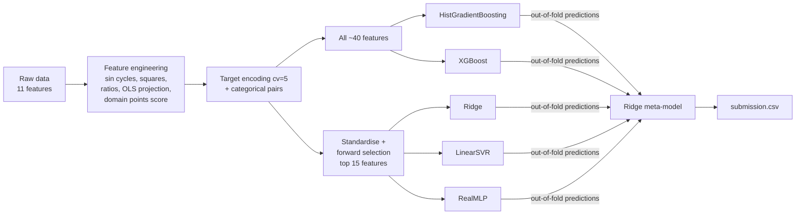

# Predicting student exam scores: 2-level stacking ensemble

**Kaggle Playground: "Predicting Student Test Scores"** · M1 Machine Learning course project (team of 4)
**Result: public leaderboard RMSE 8.624, top ~650 of ~4,300 teams (≈ top 15%)**

Tabular regression on 630k students (270k in test): predict `exam_score` from study hours,
attendance, sleep, study method, facilities, and similar fields. The final system stacks five diverse
models (gradient-boosted trees, linear models and a neural net) with a Ridge meta-model.

## Results

10-fold out-of-fold cross-validation on the full training set:

| Configuration | CV RMSE |
|---|---|
| Baseline: raw features, HistGradientBoosting | 8.781 |
| + feature engineering (interactions, ratios, cyclic features) | 8.743 |
| First stack: HGBR + Ridge + LinearSVR | 8.701 |
| XGBoost alone (tuned) | 8.680 |
| **Final stack: HGBR + XGBoost + RealMLP + Ridge + LinearSVR** | **8.658** |
| Kaggle public leaderboard | **8.624** |

## Pipeline



Key ideas:
- **Exploratory analysis first** ([notebook](notebooks/01_data_analysis.ipynb)): `study_hours` dominates (r = 0.76),
  then attendance (0.36). Age and gender carry no signal. Sleep quality and study method matter a lot.
- **Cyclic features**: sine transforms of study hours and attendance (periods 12/14/20) exposed periodic
  structure in the synthetic target that trees struggled to approximate.
- **Leakage-safe target encoding**: scikit-learn's `TargetEncoder(cv=5)` is cross-fitted, so a row is
  never encoded with its own target.
- **Two feature views for diversity**: trees get every feature. Linear models and the MLP get a compact,
  standardised top-15 subset chosen by forward selection. Their errors are less correlated, which is
  what makes stacking pay off.
- **10-fold OOF stacking**: the meta-model only ever sees out-of-fold predictions.

Slides from the final presentation (in French): [docs/slides.pdf](docs/slides.pdf)

## Run it

```bash
pip install -r requirements.txt
# download train.csv / test.csv from the competition page into data/
python train.py --data data/                 # full stack (GPU strongly recommended for XGBoost + RealMLP)
python train.py --data data/ --fast          # HGBR + Ridge + LinearSVR only, runs on a laptop CPU
python ablation.py --data data/              # reproduce the ablation table
```

No Kaggle data? `python make_synthetic_data.py` writes a small fake dataset with the same schema
so you can check the code end to end (this is what CI runs).

```
src/features.py         feature engineering, encoding, feature selection
src/models.py           level-1 model definitions and hyper-parameters
train.py                K-fold training, stacking, submission
ablation.py             step-by-step contribution of each stage
notebooks/              exploratory data analysis + 10-model benchmark
docs/slides.pdf         presentation
```

## What I would do differently

- Fit the scaler and feature selector inside each fold. They currently see the whole training set,
  a small optimistic bias on the CV score (the leaderboard score suggests it is negligible here).
- Tune the meta-model with a held-out fold rather than in-sample.
- Multi-seed averaging of the level-1 models.

Team: Anass, John-Michael JENY JEYARAJ, Sayfe-Din, Selim.
